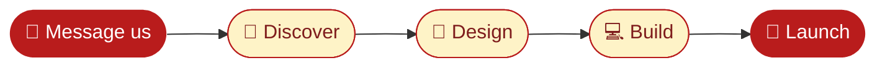

 

 

**[About](#-about-us)** · **[Services](#️-what-we-build)** · **[Projects](#-sample-projects)** · **[Process](#-how-we-work)** · **[Founders](#-meet-the-founders)** · **[FAQ](#-faq)**

---

## 👋 About us

We are **Sadeem** and **Ghani**, the two founders behind **SG Web Studio**.
We design and build fast, mobile-first websites for local businesses and freelancers, and you talk directly to the people building your site. No middle managers, no confusion.

> 💡 **Our promise:** see a demo first, then decide. No pressure if you don't like it.

| 📱 **Mobile-first** | 🎨 **Custom design** | 💬 **WhatsApp ready** | 🤝 **Direct access** |
|:---:|:---:|:---:|:---:|
| Tested on real phones | Your brand colors, no templates | Customers reach you in one tap | Talk to the founders |

## 🛠️ What we build

| | Business | What your website gets |
|---|---|---|
| 🍽️ | **Restaurants & Cafés** | Digital menu, table booking, location map |
| 🩺 | **Clinics & Hospitals** | Appointment booking, doctor profiles, WhatsApp hotline |
| 🏠 | **Real Estate** | Property listings, filters, direct agent contact |
| 💄 | **Salons & Parlours** | Services, gallery, WhatsApp booking |
| 👗 | **Online Stores** | Product catalog, WhatsApp checkout |
| 🎓 | **Academies & Schools** | Courses, fee structure, admission form |

And more: gyms, hotels, travel agencies, photographers, law firms and repair shops.

## 🎨 Sample projects

Demo websites we built to show our work. Click to open them live.

| 🩺 **CarePoint Clinic** | 🏠 **Prime Estates** | 🍽️ **Gourmet Bistro** |
|:---:|:---:|:---:|
| Appointment booking, doctor profiles | Property search, featured listings | Digital menu, table reservation |
| [**Open demo →**](https://webstudio-flax-one.vercel.app/demo/clinic) | [**Open demo →**](https://webstudio-flax-one.vercel.app/demo/real-estate) | [**Open demo →**](https://webstudio-flax-one.vercel.app/demo/restaurant) |

## 🚀 How we work

Most websites are ready in **3 to 5 days**.

| Day | Step | What happens |
|:---:|---|---|
| **1** | 🧭 Discover | We learn about your business, customers and goals |
| **2** | 🎨 Design | A custom layout in your brand colors, for your approval |
| **3–4** | 💻 Build | Fast, mobile-first code tested on real phones |
| **5** | 🚀 Launch | Your website goes live and we stay with you after launch |

## 👥 Meet the founders

| | **Sadeem** | **Ghani** |
|:---:|:---:|:---:|
| **Role** | Co-Founder · Development & Clients | Co-Founder · Support & Client Communication |
| **Does** | Builds the websites and talks to leads and clients | Supports every project and follows up with clients |
| **Focus** | `Web Development` `UI Design` | `Client Support` `Communication` |

## 🧰 Tech stack

## ❓ FAQ

<b>How long does it take to build a website?</b>

 
Usually 3 to 5 days. We start working right after we collect your requirements.

<b>I don't have any content. What should I do?</b>

 
No problem. Share your business details and photos, and we'll handle the text and design.

<b>How do I get a demo website?</b>

 
Message us on WhatsApp with your business type. We'll prepare a demo for your business, and you continue only if you like it.

<b>Do I need technical knowledge?</b>

 
Not at all. You only need to tell us about your business, and we handle all the technical work.

---

### 🚀 Ready to get your website?

 

